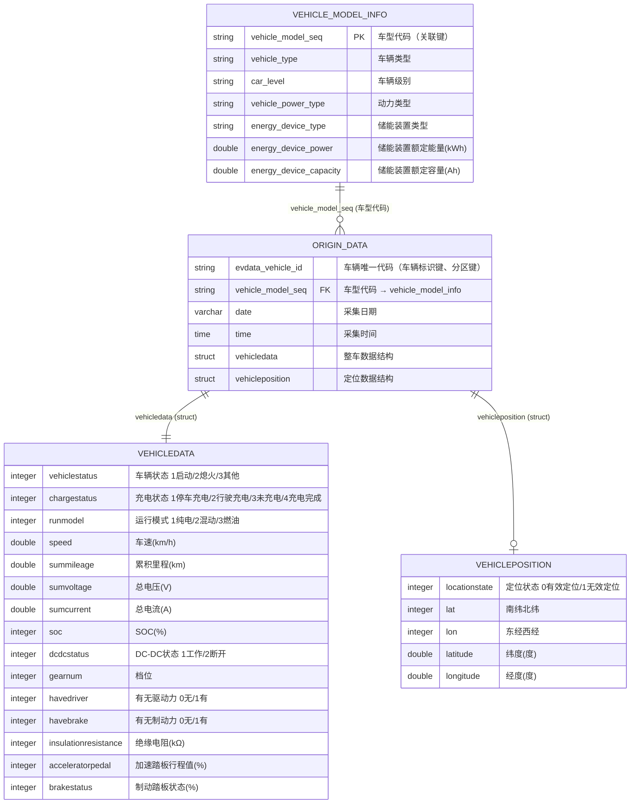
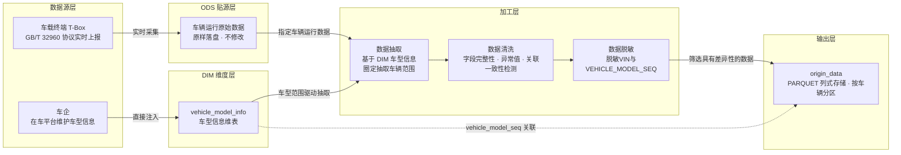

# 数据手册（Datasheet）

> **数据集名称：** 国标32960入门数据集 \
> **数据集英文名：** EV_32960_BEGINNER_DATASET \
> **数据版本号：** v1.0 \
> **创建机构：** EVData Box团队 \
> **发布日期：** 2026年9月4日 \
> **文档状态：** 正式发布

---

## 一、数据集概述与背景

### 1.1 业务场景

本数据集来源于上海市新能源汽车平台，用于“国标32960入门数据集”，并可继续用于新能源汽车数据洞察，以及新能源车辆数据质量检测与评价等。

当前样例是车辆按时间上报的**点级遥测记录**：每行包含整车状态、位置状态、车型代码、日期、时刻和脱敏车辆标识。数据集旨在支撑以下核心业务目标：

- **熟悉GB/T 32960数据**：了解数据结构，对数据进行简单分析，熟悉单个字段含义与特性，熟悉多字段的关系；
- **熟悉EVKIT与大数据相关工具**：开源工具**EVKIT**是为该类数据集量身打造，EVKIT上手简单，可以通过该工具快速了解GB/T 32960数据，从多个视角洞察数据的情况。同时，该数据集也可以通过BI工具进行可视化与分析。
- **熟悉数据质量检测治理**：参考《2022年度上海市新能源汽车数据质量检测标准》以及国标GB/T 36344-2018《信息技术 数据质量评价指标》，理解数据采集标准和数据质量评价标准协议和规范要求。理解汽车时序数据和数据反映的汽车实体，运用有效的数据分析方法和工具，进行数据质量检测工程开发实践。


#### 1.1.1 推荐教学实战用途

| 场景类型 | 场景描述 | 场景数据集 | 实战目标 | 场景难度 |
| --- | --- | --- | --- | --- |
|GB/T 32960 标准数据洞察 | 了解并洞察GB/T 32960数据的来源、数据特性与数据共性 | **数据集名称**：<br>国标32960入门数据集<br> **数据规模：**<br>十辆新能源车某一个月内的运行数据。<br>**数据内容：**<br>① 车辆运行数据：车辆状态、充电状态、运行模式、速度、累计里程、总电压、总电流、SOC、挡位和踏板状态等；<br>② 车辆位置数据：定位状态、经纬度；<br>③ 车型静态信息：车辆类型、车辆级别、动力类型、储能装置类型、额定能量和额定容量等。 | ① 了解汽车数据如何采集,并把字段变化与车辆真实运行场景联系起来。<br>② 专注于一辆车，使用 Tableau 或其他低代码 BI 工具可视化不同字段之间的关系，观察数据上报频率，洞察车辆状态与其他字段的一致性。<br>③ 使用整个教学切片探寻车辆间的共性。例如，比较同一车辆相邻记录的累计里程差，并结合时间差、速度及采样间隔判断其是否满足共同的物理与数据约束。 | 入门 |
| 新能源汽车数据质量检测治理 | 从不同业务视角对基于GB/T 32960采集的新能源汽车运行数据进行质量检测。<br>**实践方向一：**《2022年度上海市新能源汽车数据质量检测标准》开展检测。<br>**实践方向二：** 使用开源算法EVKIT EV32960的数据质量模块开展检测。<br>**实践方向三：** 参考GB/T 36344-2018《信息技术 数据质量评价指标》等规范开展质量评价。<br>可形成数据质量检测说明书、算法、报告、可视化系统和问题知识库。<br>**比赛建议：**《新能源汽车数据质量检测实战赛》。<br>**复用迭代：** 沉淀数据质量问题知识库，持续迭代并开源质量检测算法与工具。 | **数据集名称**：<br>国标32960入门数据集<br> **数据规模：**<br>数据集包括十辆具有差异性的车辆，差异性包括不同的商用种类、不同的动力类型以及不同采样频率等。<br>**数据内容：**<br>① 车辆运行数据：车辆状态、充电状态、运行模式、速度、累计里程、总电压、总电流、SOC、挡位和踏板状态等；<br>② 车辆位置数据：定位状态、经纬度；<br>③ 车型静态信息：车辆类型、车辆级别、动力类型、储能装置类型、额定能量和额定容量等。<br>**参考标准：**<br>GB/T 32960.3-2016、GB/T 32960.3-2025、《2022年度上海市新能源汽车数据质量检测标准》、GB/T 36344-2018《信息技术 数据质量评价指标》。 | ① 理解数据采集标准和数据质量评价规范。<br>② 理解数据质量的规范性、完整性、准确性、一致性和时效性。<br>③ 结合汽车时序数据及其反映的车辆实体，开展异常数据识别和质量检测规则开发。 | 入门+ |

当前数据还可支持以下延伸方向：

- **停留行为识别**：结合速度、累计里程、位置和车辆状态识别候选停留段，并区分持续观测与长时间未上报。
- **充电过程识别**：以充电状态为主要信号，结合 SOC、总电流、总电压、速度和车辆状态交叉确认候选充电段。
- **补能行为描述**：统计候选充电次数、持续时间、SOC 变化、时段分布和车型差异。
- **数据分析教学与方法验证**：用于时间序列整理、状态切分、数据质量检查、特征工程和可视化练习。

### 1.2 数据来源


| 来源系统 | 对应表 | 抽取方式 |
|---------|--------|---------|
| 车平台 | vehicle_model_info | 选取差异性较大的车辆 |
| 车平台 | origin_data | 一次性抽取 |

### 1.3 适用场景与慎用建议

**适用场景：**

- 用于数据初步洞察，形成对数据的理解，作为后续深入分析的基础认知；
- 点级车辆状态、停留候选和充电候选的时序分析；
- 车辆与车型层面的采样频率、状态分布、SOC/里程变化和质量诊断；
- 按车型动力类型、储能装置类型及标称参数进行分层描述；
- 基于明确规则派生停留段、充电段，并保留可追溯的起止点证据。

**慎用或不适用场景：**

- **不适合用于微观行为探究**：运行数据时间间隔10s或30s，不适合对三急行为（急加速、急减速、急转弯）等数据频率要求极高的场景。
- **不适合用于单车长周期衰减分析**：本数据集面向多车辆群体横向分析；如需单车电池衰减/寿命等长周期纵向追踪，请使用新能源汽车长周期数运行据集。
- **不包含三电深度字段**：本数据集不含发动机、驱动电机、电池极值（单体电压/探针温度）等结构，相关诊断分析请使用新能源汽车长周期数运行据集。

---

## 二、数据结构与规模

### 2.1 核心统计指标

| 指标 | 数值 |
|-----|------|
| 数据时间范围 | 某年11月1日 — 11月30日 |
| 涉及表数量 | 2 张（origin_data、vehicle_model_info） |
| 总文件大小 | 约 26.26 MB（PARQUET 格式） |
| 总数据行数 | 约 1,612,832 行（以 origin_data 表为主） |
| origin_data 表行数 | 约 1,612,822 行 |
| vehicle_model_info 表行数 | 10 行 |
| 存储格式 | PARQUET 格式 |
| 分区策略 | origin_data 表按 `evdata_vehicle_id`（车辆）分区|

### 2.2 实体关系图（ER 图）



### 2.3 关联逻辑说明

- **运行点表 `vehicle_model_seq`（多） →  车型静态信息表 `vehicle_model_seq`（一）：** 预期为多对一关系。
- **嵌套结构**：`origin_data` 中 `vehicledata`（整车数据）为 struct，每行数据含一个，`vehicledata`包含多个子字段，需展开使用。
- **车辆时间线：** 按 `evdata_vehicle_id` 分组，将 `date` 与 `time` 组合成统一时间，再按时间排序。
- **记录级唯一性：** 当前没有已确认的单列主键。`(evdata_vehicle_id, date, time)` 可作为重复时间键检查条件，但同一车辆同一时刻可能存在多条内容不同的上报，不能未经检查直接去重。

### 2.4 字段级描述（数据字典）
> 敏感等级：🔴 L3-高（车辆唯一标识，可关联到具体车辆）/ 🟡 L2-中（时间类字段）/ 🟢 L1-低（车辆运行遥测数据）。 \
> 标准编码约定：**254(0xFE)=异常、255(0xFF)=无效**（多字节为 65534/65535，4字节里程为 4294967294/4294967295）。

### 1. origin_data 根节点字段

| 字段名(Field) | 数据类型 | 中文释义 | 必填 | 主/外键 | 取值范围/枚举值 | 单位 | 敏感等级 | 处理逻辑/备注 |
|:---|:---|:---|:---:|:---|:---|:---:|:---:|:---|
| evdata_vehicle_id | `STRING` | 车辆唯一代码 | ✅ | 车辆标识键、分区键 | 车辆唯一标识（脱敏ID） | — | 🔴 L3 | 单车辆多条记录，非主键；已脱敏 |
| vehicle_model_seq | `STRING` | 车型代码 | ✅ | **FK**→vehicle_model_info.vehicle_model_seq | 关联车型维表 | — | 🟢 L1 | 与vehicle_model_info关联的外键 |
| time | `TIME` | 采集时间 | ✅ | — | HH:mm:ss | — | 🟡 L2 | 时间，UTC+8 |
| date | `VARCHAR` | 日期 | ✅ | — | MMdd | — | 🟡 L2 | — |

### 2. vehicledata 整车数据（struct）

| 字段名(Field) | 数据类型 | 中文释义 | 必填 | 主/外键 | 取值范围/枚举值 | 单位 | 敏感等级 | 处理逻辑/备注 |
|:---|:---|:---|:---:|:---|:---|:---:|:---:|:---|
| vehicledata.vehiclestatus | `INTEGER` | 车辆状态 | ✅ | — | 1：启动；2：熄火；3：其他；254：异常；255：无效 | — | 🟢 L1 | 254/255应过滤或置NULL |
| vehicledata.chargestatus | `INTEGER` | 充电状态 | ✅ | — | 1：停车充电；2：行驶充电；3：未充电；4：充电完成；254：异常；255：无效 | — | 🟢 L1 | 254/255应过滤或置NULL |
| vehicledata.runmodel | `INTEGER` | 运行模式 | ✅ | — | 1：纯电；2：混动；3：燃油；254：异常；255：无效 | — | 🟢 L1 | BEV车通常为1，PHEV随工况切换 |
| vehicledata.speed | `DOUBLE` | 车速 | ✅ | — | 0~220，0.1步长；65534：异常；65535：无效 | km/h | 🟢 L1 | — |
| vehicledata.summileage | `DOUBLE` | 累积里程 | ✅ | — | 0~999999.9，0.1步长；4294967294/4294967295：异常/无效 | km | 🟢 L1 | 只增不减，可用于校验数据连续性 |
| vehicledata.sumvoltage | `DOUBLE` | 总电压 | ✅ | — | 0~1000，0.1步长；65534：异常；65535：无效 | V | 🟢 L1 | — |
| vehicledata.sumcurrent | `DOUBLE` | 总电流 | ✅ | — | -1000~+1000，0.1步长；65534：异常；65535：无效 | A | 🟢 L1 | 负值放电、正值充电 |
| vehicledata.soc | `INTEGER` | SOC剩余电量 | ✅ | — | 0~100，1步长；254：异常；255：无效 | % | 🟢 L1 | 剩余电量百分比 |
| vehicledata.dcdcstatus | `INTEGER` | DC-DC状态 | ✅ | — | 1：工作；2：断开；254：异常；255：无效 | — | 🟢 L1 | — |
| vehicledata.gearnum | `INTEGER` | 档位 | ✅ | — | 0：空挡；1\~6：1\~6挡；13：R倒挡；14：D前进挡；15：P停车挡 | — | 🟢 L1 | 枚举映射后再分析 |
| vehicledata.havedriver | `INTEGER` | 有无驱动力 | ✅ | — | 0：无；1：有 | — | 🟢 L1 | 注意：与havebrake含义相反，勿混淆 |
| vehicledata.havebrake | `INTEGER` | 有无制动力 | ✅ | — | 0：无；1：有 | — | 🟢 L1 | — |
| vehicledata.insulationresistance | `INTEGER` | 绝缘电阻 | — | — | 0~60000，1步长 | kΩ | 🟢 L1 | 低于100kΩ存在漏电风险 |
| vehicledata.acceleratorpedal | `INTEGER` | 加速踏板行程值 | — | — | 0~100，1步长；254：异常；255：无效 | % | 🟢 L1 | — |
| vehicledata.brakestatus | `INTEGER` | 制动踏板状态 | — | — | 0~100行程百分比；0：制动关；101：制动有效；254：异常；255：无效 | % | 🟢 L1 | 注意101为特殊状态位，非行程值 |

### 3. vehicleposition 定位数据（struct，可为空）

| 字段名(Field) | 数据类型 | 中文释义 | 必填 | 主/外键 | 取值范围/枚举值 | 单位 | 敏感等级 | 处理逻辑/备注 |
|:---|:---|:---|:---:|:---|:---|:---:|:---:|:---|
| vehicleposition.locationstate | `INTEGER` | 定位状态 | ✅ | — | 0：有效定位；1：无效定位 | — | 🟢 L1 | 当数据通信正常，而不能获取定位信息时，发送最后一次有效定位信息，并将定位状态位置为无效 |
| vehicleposition.lat | `INTEGER` | 南纬北纬 | — | — | 0：北纬；1：南纬 | — | 🟡 L2 | — |
| vehicleposition.lon | `INTEGER` | 东经西经 | — | — | 0：东经；1：西经 | — | 🟡 L2 | — |
| vehicleposition.latitude | `DOUBLE` | 纬度 | — | — | 以度为单位的纬度值乘以10^6，精确到百万分之一度 | ° | 🟡 L2 | — |
| vehicleposition.longitude | `DOUBLE` | 经度 | — | — | 以度为单位的经度值乘以10^6，精确到百万分之一度 | ° | 🟡 L2 | — |

> `(longitude, latitude) = (0, 0)` 应作为“坐标不可用/待判定”处理，不应当作真实地理位置参与
> 距离、围栏或地图分析。是否由定位无效、上游填零或脱敏造成，需要结合 `locationstate` 码表确认。

### 4. vehicle_model_info 车型信息维表

| 字段名(Field) | 数据类型 | 中文释义 | 必填 | 主/外键 | 取值范围/枚举值 | 单位 | 敏感等级 | 处理逻辑/备注 |
|:---|:---|:---|:---:|:---|:---|:---:|:---:|:---|
| vehicle_model_seq | `STRING` | 车型代码 | ✅ | **PK** | 正整数，唯一 | — | 🟢 L1 | 主键，被origin_data引用 |
| vehicle_type | `STRING` | 车辆类型 | ✅ | — | Sedan/SUV/MPV（以维表枚举为准） | — | 🟢 L1 | — |
| car_level | `STRING` | 车辆级别 | — | — | A00/A0/A/B/C/D（以维表枚举为准） | — | 🟢 L1 | — |
| vehicle_power_type | `STRING` | 动力类型 | ✅ | — | BEV纯电 / PHEV插混 / FCEV燃料电池 | — | 🟢 L1 | 决定哪些结构字段有值 |
| energy_device_type | `STRING` | 储能装置类型 | — | — | 如：磷酸铁锂电池/三元材料电池 | — | 🟢 L1 | — |
| energy_device_power | `DOUBLE` | 储能装置额定能量 | — | — | ≥0 | kWh | 🟢 L1 | — |
| energy_device_capacity | `DOUBLE` | 储能装置额定容量 | — | — | ≥0 | Ah | 🟢 L1 | — |
---

## 三、数据质量与治理

### 3.1 数据血缘与加工流程




**加工环节说明：**

1. **采集层**：车平台实时采集车辆运行数据，并写入 ODS 层；车企在车平台维护车型信息，直接注入 DIM 层。
2. **抽取层**：基于 DIM 层车型信息，抽取指定车辆运行数据。
3. **加工层**：执行字段完整性、异常值、关联一致性等检测，筛选具有差异性的车辆数据。
4. **输出层**：清洗完成后导出为 PARQUET 格式，按车辆分区存储。

### 3.2 数据质量校验结论

| 问题类别 | 涉及字段 | 影响程度 | 处理方式 | 备注 |
|---------|---------|---------|---------|------|
| 时间空白 | `date`,`time` | 低 | 未处理 | 停车熄火后不采集数据，但也有可能是数据真的缺失，可以依据累计里程`vehicledata.summileage`判断 |
| 数据采集频率 | ALL | 中 | 未处理 | 数据采集时间间隔和车辆有关，分为10s或30s一条，不同频率的数据所含信息密度和处理方式可能不同 |
| 数据唯一性问题 | `evdata_vehicle_id`,`date`,`time` | 高 | 未处理 | 数据差分再除以时间差分可能会得到无穷大，并且主键不唯一 |
| `vehicledata`与`vehicleposition`存在空白记录 | `vehicledata`与`vehicleposition` | 高 | 未处理 | 需要剔除空值记录 |
| 时区问题 | `date`,`time` | 中 | 统一为北京时间（UTC+8） | 跨时区用户需注意 |
| 坐标系 | `longitude`,`latitude` | 高 | 统一为`WGS84`坐标系 | 使用坐标计算距离时需要使用`WGS84` |


### 3.3 数据一致性校验

- **主键一致性校验**：`vehicle_model_info.vehicle_model_seq` 在维表中唯一、无重复。
- **外键一致性校验**：`origin_data.vehicle_model_seq` 与 `vehicle_model_info` 表中主键类型一致，维表命中率100%。
- **分区策略校验**：origin_data 按 `evdata_vehicle_id`（车辆ID）分区，查询不带分区将全表扫描，影响查询效率。

### 3.4 隐私与安全合规

| 合规项 | 说明 |
|--------|------|
| 数据脱敏 | `evdata_vehicle_id`,`vehicle_model_seq` 已随机编码脱敏，不可逆推原始ID |
| 敏感信息排除 | 不包含手机号、身份证号、银行卡号、收货地址等PII信息 |
| 数据授权 | 数据集内部使用需经审批；对外共享需签署数据保密协议 |
| 合规依据 | 符合《个人信息保护法》《数据安全法》相关要求 |
| 访问控制 | 仅限授权团队成员访问，禁止二次分发 |

---

## 四、版本与维护

### 4.1 版本更新记录

| 版本号 | 日期 | 变更内容 | 负责人 |
|:---|:---|:---|:---|
| v1.0 | 2026-09-04 | 首次发布，覆盖整车数据 + 定位数据 | EVData Box 团队 |

### 4.2 更新计划

- **更新频率**：按年更新
- **更新内容**：每年发布新一年新增数据
- **下次更新**：预计2027年9月1日发布新一年数据

### 4.3 联系方式

| 联系方式 | 联系信息 |
|:---|:---|
| EVData Box 团队 | labs@shevdc.org |

---

## 五、引用与致谢

### 5.1 标准引用格式

**学术引用（BibTeX）：**

```bibtex
@dataset{EV_32960_BEGINNER_DATASET,
  title   = {{国标32960入门数据集 v1.0}},
  author  = {{EVData Box 团队}},
  year    = {2026},
  version = {1.0},
  publisher = {上海市新能源汽车公共数据采集与监测研究中心}
}
```

**文本引用格式：**

> 上海市新能源汽车公共数据采集与监测研究中心EVData Box团队. 新能源汽车多车辆运行数据集 (v1.0) [Data set]. 上海市新能源汽车公共数据采集与监测研究中心, 2026.

### 5.2 致谢

感谢以下团队在数据采集、清洗与治理过程中的贡献：
- 平台技术团队：负责采集系统建设与日志采集链路维护
- 数据中台团队：负责数据清洗、质量管控与数据集发布
- 安全合规团队：负责数据脱敏方案设计与合规审查

---

## 六、使用建议与避坑指南

### 6.1 最容易犯的错误

#### 1. 把每个点当作一次停留或充电事件

一行只是一个上报点。同一事件通常包含多个连续点，事件数不能用点数代替；事件派生需要按车辆排序、设置连续性规则，并处理大间隔和数据集起止边界。

#### 2. 只凭 `speed=0` 判断停留

零速可能是瞬时停车、拥堵、信号灯等待或无效值。至少应结合持续时间、累计里程、坐标、车辆状态和采样连续性；坐标不可用时要降低结论强度。

#### 3. 只凭 `chargestatus` 判断完整充电过程

状态码是重要信号，但可能存在单点抖动、异步上报或异常编码。应结合连续记录、SOC 变化、总电流、总电压、速度和车辆状态交叉检查，并说明电流正负方向尚需提供方确认。

#### 4. 把长时间未上报自动补成停留

两个点之间的长空档不证明车辆一直停在原地。除非有可靠的端点与其他字段证据，否则应将该区间标为不可观测，不做线性插值，也不把它计入停留/充电时长。

#### 5. 忽略 `date` 不含年份和时区

样例日期为 `0101`，无法单独确定年份。分析前必须明确年份、时区、是否跨年以及日期是否经过脱敏偏移。兼容程序补出的默认年份不能自动当作数据真实年份。

#### 6. 用上报行数衡量持续时长或车辆权重

采样频率高的车辆会产生更多行。时长应由相邻时间点或事件区间计算；跨车辆比较时，应说明按点、按事件还是按车加权，并进行采样频率敏感性检查。应该先计算单车内部的情况，再统一和其他车辆一并计算指标。

### 6.2 重要注意事项

#### 1. date 是VARCHAR

`date` 为 可变长度字符串（如 0908），写 `date > 0101` 无法命中，应先转数值后过滤（如 `date::NUMERIC BETWEEN 0901 AND 0930`）

#### 2. 本数据集不含三电深度字段

本数据集**不含** enginedata（发动机）、extremevalue（电池极值/单体电压）、motordatalist（驱动电机）结构。需要电池单体电压、电机温度/转矩、发动机转速等字段时，请使用长周期数据集或对应专项数据集，勿在本表中查找。

#### 3. 位置数据的合规红线

即使车辆 ID 已脱敏，连续轨迹仍可能间接关联到个人。任何分析都应停留在群体/区域聚合层面（如区域车辆数、平均停留时长），不得输出单车可识别的轨迹明细用于对外场景。

---

> **文档维护说明：** 本数据手册随数据集版本同步更新。如发现数据质量问题或文档描述不准确，请联系 labs@shevdc.org。
>
完整字段数据字典请参阅 `国标32960入门数据集.xlsx`。

---
