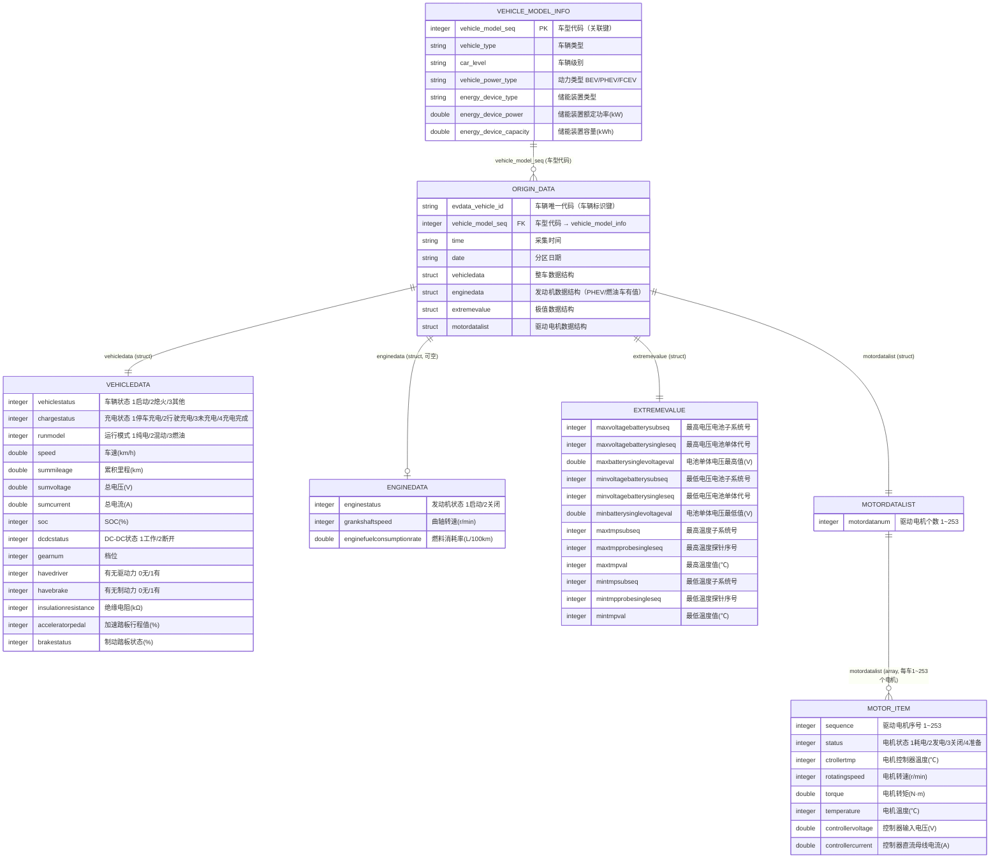
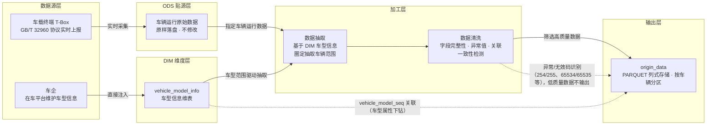

# 数据手册（Datasheet）

> **数据集名称：** 新能源汽车长周期运行数据集 \
> **数据集英文名：** EV_LONG_PERIOD_DATASET \
> **数据版本号：** v1.0 \
> **创建机构：** EVData Box团队 \
> **发布日期：** 2026年9月4日 \
> **文档状态：** 正式发布

---

## 一、数据集概述与背景

### 1.1 业务场景

本数据集来源于上海市新能源汽车平台，涵盖车辆一段长周期时间窗口内的运行数据。数据集旨在支撑以下核心业务目标：

- **驾驶行为演变**：探查在较长时间尺度上，用户的行驶、充电行为如何演变以及潜在的因素有哪些；
- **动力电池衰减**：探究动力电池衰减的核心影响因素，估算电池健康度并结合影响因素总结延缓衰减的措施。

### 1.2 数据来源

数据抽取自平台线上生产环境，主要来源包括：

| 来源系统 | 对应表 | 抽取方式 |
|---------|--------|---------|
| 车平台 | vehicle_model_info | 一次性抽取 |
| 车平台 | origin_data | 一次性抽取 |

### 1.3 适用场景与慎用建议

**适用场景：**
- 新能源汽车驾驶行为演变
- 新能源汽车动力电池衰减

**慎用场景：**
- **不适合用于极寒/极热工况分析**：数据覆盖地区以长三角地区为主，对极端低温/高温工况的覆盖有限，不建议外推至极端气候结论。
- **不适合直接推断因果关系**：数据为车载传感器采集，均未进行实车验证，结论需结合业务判断。
- **不适合融合个人信息**：数据以车为主体，涉及路网、电网等城市资源，不以个人行为准确挂钩。

---

## 二、数据结构与规模

### 2.1 核心统计指标

| 指标 | 数值 |
|-----|------|
| 数据时间范围 | 某年1月1日 — 12月31日 |
| 涉及表数量 | 2 张（origin_data、vehicle_model_info） |
| 总文件大小 | 约 580MB（PARQUET 格式） |
| 总数据行数 | 约 3600 万行（以 origin_data 表为主） |
| origin_data 表行数 | 约 3600 万行 |
| vehicle_model_info 表行数 | 40 行 |
| 存储格式 | PARQUET 格式 |
| 分区策略 | origin_data 表按 `evdata_vehicle_id`（车辆）分区|

### 2.2 实体关系图（ER图）

> 关联关系：`origin_data.vehicle_model_seq`（外键，多）→ `vehicle_model_info.vehicle_model_seq`（主键，一），即**一个车型对应多条车辆上报数据**。
> origin_data 为嵌套结构（struct/array），ER 图中按结构组展开展示。



## 关联逻辑说明

1. **主表关系（两表核心关联）**：`vehicle_model_info`（车型维表，一） : `origin_data`（车辆上报事实数据，多）= 1 : N，通过 `vehicle_model_seq` 关联。分析时先按车型维度筛选/聚合，再下钻到车辆明细。
2. **嵌套结构**：origin_data 中 vehicledata（整车数据）、enginedata（发动机数据）、extremevalue（极值数据）为 struct，每行数据各含一个；motordatalist 为 struct 套 array，array 长度由 `motordatanum` 决定（1~253 个电机），使用时需 explode 展开。
3. **空值规律**：纯电车（BEV）enginedata 为空；燃油车 motordatalist 相关字段可能为空；查询前建议按 `vehicle_power_type` 区分动力类型。
4. **分区字段**：`evdata_vehicle_id` 为分区字段，查询必须带 `evdata_vehicle_id` 过滤。

---

## 字段级描述（数据字典）

> 敏感等级：🔴 L3-高（车辆唯一标识，可关联到具体车辆）/ 🟡 L2-中（时间类字段）/ 🟢 L1-低（车辆运行遥测数据）。 \
> 标准编码约定：**254(0xFE)=异常、255(0xFF)=无效**（多字节为 65534/65535，4字节里程为 4294967294/4294967295）。

### 1. origin_data 根节点字段

| 字段名(Field) | 数据类型 | 中文释义 | 必填 | 主/外键 | 取值范围/枚举值 | 单位 | 敏感等级 | 处理逻辑/备注 |
|:---|:---|:---|:---:|:---|:---|:---:|:---:|:---|
| evdata_vehicle_id | `STRING` | 车辆唯一代码 | ✅ | 车辆标识键、分区键 | 车辆唯一标识（脱敏ID） | — | 🔴 L3 | 单车辆多条记录，非主键；已脱敏 |
| vehicle_model_seq | `INTEGER` | 车型代码 | ✅ | **FK**→vehicle_model_info.vehicle_model_seq | 关联车型维表 | — | 🟢 L1 | 与vehicle_model_info关联的外键 |
| time | `STRING` | 采集时间 | ✅ | — | HH:mm:ss | — | 🟡 L2 | 字符串，UTC+8 |
| date | `STRING` | 日期 | ✅ | — | MMdd | — | 🟡 L2 | — |

### 2. vehicledata 整车数据（struct）

| 字段名(Field) | 数据类型 | 中文释义 | 必填 | 主/外键 | 取值范围/枚举值 | 单位 | 敏感等级 | 处理逻辑/备注 |
|:---|:---|:---|:---:|:---|:---|:---:|:---:|:---|
| vehicledata.vehiclestatus | `INTEGER` | 车辆状态 | ✅ | — | 1：启动；2：熄火；3：其他；254：异常；255：无效 | — | 🟢 L1 | 254/255应过滤或置NULL |
| vehicledata.chargestatus | `INTEGER` | 充电状态 | ✅ | — | 1：停车充电；2：行驶充电；3：未充电；4：充电完成；254：异常；255：无效 | — | 🟢 L1 | 254/255应过滤或置NULL |
| vehicledata.runmodel | `INTEGER` | 运行模式 | ✅ | — | 1：纯电；2：混动；3：燃油；254：异常；255：无效 | — | 🟢 L1 | BEV车通常为1，PHEV随工况切换 |
| vehicledata.speed | `DOUBLE` | 车速 | ✅ | — | 0~220，0.1步长；65534：异常；65535：无效 | km/h | 🟢 L1 | — |
| vehicledata.summileage | `DOUBLE` | 累积里程 | ✅ | — | 0~999999.9，0.1步长；4294967294/4294967295：异常/无效 | km | 🟢 L1 | 只增不减，可用于校验数据连续性 |
| vehicledata.sumvoltage | `DOUBLE` | 总电压 | ✅ | — | 0~1000，0.1步长；65534：异常；65535：无效 | V | 🟢 L1 | — |
| vehicledata.sumcurrent | `DOUBLE` | 总电流 | ✅ | — | -1000~+1000，0.1步长；65534：异常；65535：无效 | A | 🟢 L1 | 负值放电、正值充电 |
| vehicledata.soc | `INTEGER` | SOC剩余电量 | ✅ | — | 0~100，1步长；254：异常；255：无效 | % | 🟢 L1 | 剩余电量百分比 |
| vehicledata.dcdcstatus | `INTEGER` | DC-DC状态 | ✅ | — | 1：工作；2：断开；254：异常；255：无效 | — | 🟢 L1 | — |
| vehicledata.gearnum | `INTEGER` | 档位 | ✅ | — | 0：空挡；1\~6：1\~6挡；13：R倒挡；14：D前进挡；15：P停车挡 | — | 🟢 L1 | 枚举映射后再分析 |
| vehicledata.havedriver | `INTEGER` | 有无驱动力 | ✅ | — | 0：无；1：有 | — | 🟢 L1 | 注意：与havebrake含义相反，勿混淆 |
| vehicledata.havebrake | `INTEGER` | 有无制动力 | ✅ | — | 0：无；1：有 | — | 🟢 L1 | — |
| vehicledata.insulationresistance | `INTEGER` | 绝缘电阻 | — | — | 0~60000，1步长 | kΩ | 🟢 L1 | 低于100kΩ存在漏电风险 |
| vehicledata.acceleratorpedal | `INTEGER` | 加速踏板行程值 | — | — | 0~100，1步长；254：异常；255：无效 | % | 🟢 L1 | — |
| vehicledata.brakestatus | `INTEGER` | 制动踏板状态 | — | — | 0~100行程百分比；0：制动关；101：制动有效；254：异常；255：无效 | % | 🟢 L1 | 注意101为特殊状态位，非行程值 |

### 3. enginedata 发动机数据（struct，BEV纯电车为空）

| 字段名(Field) | 数据类型 | 中文释义 | 必填 | 主/外键 | 取值范围/枚举值 | 单位 | 敏感等级 | 处理逻辑/备注 |
|:---|:---|:---|:---:|:---|:---|:---:|:---:|:---|
| enginedata.enginestatus | `INTEGER` | 发动机状态 | — | — | 1：启动；2：关闭；254：异常；255：无效 | — | 🟢 L1 | BEV纯电车该结构为空 |
| enginedata.grankshaftspeed | `INTEGER` | 曲轴转速 | — | — | 0~60000，1步长；65534：异常；65535：无效 | r/min | 🟢 L1 | BEV车为空 |
| enginedata.enginefuelconsumptionrate | `DOUBLE` | 发动机燃料消耗率 | — | — | 0~600，0.01步长；65534：异常；65535：无效 | L/100km | 🟢 L1 | 仅发动机启动时有值 |

### 4. extremevalue 极值数据（struct）

| 字段名(Field) | 数据类型 | 中文释义 | 必填 | 主/外键 | 取值范围/枚举值 | 单位 | 敏感等级 | 处理逻辑/备注 |
|:---|:---|:---|:---:|:---|:---|:---:|:---:|:---|
| extremevalue.maxvoltagebatterysubseq | `INTEGER` | 最高电压电池子系统号 | ✅ | — | 1~250；254：异常；255：无效 | — | 🟢 L1 | 定位最高电压单体位置 |
| extremevalue.maxvoltagebatterysingleseq | `INTEGER` | 最高电压电池单体代号 | ✅ | — | 1~250；254：异常；255：无效 | — | 🟢 L1 | — |
| extremevalue.maxbatterysinglevoltageval | `DOUBLE` | 电池单体电压最高值 | ✅ | — | 0~15，0.001步长；65534：异常；65535：无效 | V | 🟢 L1 | — |
| extremevalue.minvoltagebatterysubseq | `INTEGER` | 最低电压电池子系统号 | ✅ | — | 1~250；254：异常；255：无效 | — | 🟢 L1 | — |
| extremevalue.minvoltagebatterysingleseq | `INTEGER` | 最低电压电池单体代号 | ✅ | — | 1~250；254：异常；255：无效 | — | 🟢 L1 | — |
| extremevalue.minbatterysinglevoltageval | `DOUBLE` | 电池单体电压最低值 | ✅ | — | 0~15，0.001步长；65534：异常；65535：无效 | V | 🟢 L1 | — |
| extremevalue.maxtmpsubseq | `INTEGER` | 最高温度子系统号 | ✅ | — | 1~250；254：异常；255：无效 | — | 🟢 L1 | — |
| extremevalue.maxtmpprobesingleseq | `INTEGER` | 最高温度探针序号 | ✅ | — | 1~250；254：异常；255：无效 | — | 🟢 L1 | — |
| extremevalue.maxtmpval | `INTEGER` | 最高温度值 | ✅ | — | -40~+210，1步长；254：异常；255：无效 | ℃ | 🟢 L1 | — |
| extremevalue.mintmpsubseq | `INTEGER` | 最低温度子系统号 | ✅ | — | 1~250；254：异常；255：无效 | — | 🟢 L1 | — |
| extremevalue.mintmpprobesingleseq | `INTEGER` | 最低温度探针序号 | ✅ | — | 1~250；254：异常；255：无效 | — | 🟢 L1 | — |
| extremevalue.mintmpval | `INTEGER` | 最低温度值 | ✅ | — | -40~+210，1步长；254：异常；255：无效 | ℃ | 🟢 L1 | — |

### 5. motordatalist 驱动电机数据（struct + array，需 explode 展开）

| 字段名(Field) | 数据类型 | 中文释义 | 必填 | 主/外键 | 取值范围/枚举值 | 单位 | 敏感等级 | 处理逻辑/备注 |
|:---|:---|:---|:---:|:---|:---|:---:|:---:|:---|
| motordatalist.motordatanum | `INTEGER` | 驱动电机个数 | ✅ | — | 1~253 | 个 | 🟢 L1 | 决定array展开后的行数 |
| motordatalist.motordatalist[].sequence | `INTEGER` | 驱动电机序号 | ✅ | — | 1~253 | — | 🟢 L1 | array需explode展开 |
| motordatalist.motordatalist[].status | `INTEGER` | 驱动电机状态 | ✅ | — | 1：耗电；2：发电；3：关闭；4：准备；254：异常；255：无效 | — | 🟢 L1 | 制动能量回收时为2发电 |
| motordatalist.motordatalist[].ctrollertmp | `INTEGER` | 驱动电机控制器温度 | — | — | -40~+210，1步长；254：异常；255：无效 | ℃ | 🟢 L1 | — |
| motordatalist.motordatalist[].rotatingspeed | `INTEGER` | 驱动电机转速 | ✅ | — | -20000~45531，1步长；65534：异常；65535：无效 | r/min | 🟢 L1 | 负转为反转 |
| motordatalist.motordatalist[].torque | `DOUBLE` | 驱动电机转矩 | — | — | -2000~4553.1，0.1步长；65534：异常；65535：无效 | N·m | 🟢 L1 | 负转矩为制动回收 |
| motordatalist.motordatalist[].temperature | `INTEGER` | 驱动电机温度 | — | — | -40~+210，1步长；254：异常；255：无效 | ℃ | 🟢 L1 | — |
| motordatalist.motordatalist[].controllervoltage | `DOUBLE` | 电机控制器输入电压 | — | — | 0~6000，0.1步长；65534：异常；65535：无效 | V | 🟢 L1 | — |
| motordatalist.motordatalist[].controllercurrent | `DOUBLE` | 电机控制器直流母线电流 | — | — | -1000~+1000，0.1步长；65534：异常；65535：无效 | A | 🟢 L1 | — |

### 6. vehicle_model_info 车型信息维表

| 字段名(Field) | 数据类型 | 中文释义 | 必填 | 主/外键 | 取值范围/枚举值 | 单位 | 敏感等级 | 处理逻辑/备注 |
|:---|:---|:---|:---:|:---|:---|:---:|:---:|:---|
| vehicle_model_seq | `INTEGER` | 车型代码 | ✅ | **PK** | 正整数，唯一 | — | 🟢 L1 | 主键，被origin_data引用 |
| vehicle_type | `STRING` | 车辆类型 | ✅ | — | Sedan/SUV/MPV（以维表枚举为准） | — | 🟢 L1 | — |
| car_level | `STRING` | 车辆级别 | — | — | A00/A0/A/B/C/D（以维表枚举为准） | — | 🟢 L1 | — |
| vehicle_power_type | `STRING` | 动力类型 | ✅ | — | BEV纯电 / PHEV插混 / FCEV燃料电池 | — | 🟢 L1 | 决定哪些结构字段有值 |
| energy_device_type | `STRING` | 储能装置类型 | — | — | 如：磷酸铁锂电池/三元材料电池 | — | 🟢 L1 | — |
| energy_device_power | `DOUBLE` | 储能装置额定能量 | — | — | ≥0 | kWh | 🟢 L1 | — |
| energy_device_capacity | `DOUBLE` | 储能装置额定容量 | — | — | ≥0 | Ah | 🟢 L1 | — |
---

## 三、数据质量与治理

### 3.1 数据血缘与加工流程




**加工环节说明：**

1. **采集层**：车平台实时采集车辆运行数据，并写入 ODS 层；车企在车平台维护车型信息，直接注入 DIM 层。
2. **抽取层**：基于 DIM 层车型信息，抽取指定车辆运行数据。
3. **清洗层**：执行字段完整性、异常值、关联一致性等检测，筛选高质量的车辆数据。
4. **输出层**：清洗完成后导出为 PARQUET 格式，按车辆分区存储。

### 3.2 已知数据质量问题

| 问题类别 | 涉及字段 | 影响程度 | 处理方式 | 备注 |
|---------|---------|---------|---------|------|
| 时间空白 | `date`,`time` | 低 | 未处理 | 停车熄火后不采集数据，但也有可能是数据真的缺失，可以依据累计里程`vehicledata.summileage`判断 |
| 数据采集频率 | ALL | 中 | 未处理 | 数据采集时间间隔和车辆有关，分为10s或30s一条，不同频率的数据所含信息密度和处理方式可能不同 |
| 时区问题 | `date`,`time` | 中 | 统一为北京时间（UTC+8） | 跨时区用户需注意 |

### 3.3 数据一致性校验

- **主键唯一性**：origin_data.evdata_vehicle_id 和 vehicle_model_info.vehicle_model_seq 均已验证唯一，无重复。
- **外键引用完整性**：origin_data 中所有 vehicle_model_seq 均可在对应主表中找到匹配记录（引用完整性100%）。
- **分区完整性**：origin_data 表覆盖 100辆车，每辆分区均非空。

### 3.4 隐私与安全合规

| 合规项 | 说明 |
|--------|------|
| 数据脱敏 | `evdata_vehicle_id` 已随机编码脱敏，不可逆推原始ID |
| 敏感信息排除 | 不包含手机号、身份证号、银行卡号、收货地址等PII信息 |
| 数据授权 | 数据集内部使用需经审批；对外共享需签署数据保密协议 |
| 合规依据 | 符合《个人信息保护法》《数据安全法》相关要求 |
| 访问控制 | 仅限授权团队成员访问，禁止二次分发 |

---

## 四、版本与维护

### 4.1 版本更新记录

| 版本号 | 日期 | 变更内容 | 负责人 |
|--------|------|---------|--------|
| v1.0 | 2026-09-04 | 首次发布，覆盖某年1月-12月数据 | EVData Box团队 |

### 4.2 更新计划

- **更新频率**：按年更新
- **更新内容**：每年发布新一年新增数据
- **下次更新**：预计2027年9月1日发布新一年数据

### 4.3 联系方式

| 角色 | 联系信息 |
|------|---------|
| EVData Box团队 | labs@shevdc.org |


---

## 五、引用与致谢

### 5.1 标准引用格式

**学术引用（BibTeX）：**

```bibtex
@dataset{EV_LONG_PERIOD_DATASET,
  title     = {新能源汽车长周期运行数据集 v1.0},
  author    = {{EVData Box 团队}},
  year      = {2026},
  version   = {1.0},
  publisher = {上海市新能源汽车公共数据采集与监测研究中心}
}
```

**文本引用格式：**

> 上海市新能源汽车公共数据采集与监测研究中心EVData Box团队. 新能源汽车长周期运行数据集 (v1.0) [Data set]. 上海市新能源汽车公共数据采集与监测研究中心, 2026.

### 5.2 致谢

感谢以下团队在数据采集、清洗与治理过程中的贡献：
- 平台技术团队：负责采集系统建设与日志采集链路维护
- 数据中台团队：负责数据清洗、质量管控与数据集发布
- 安全合规团队：负责数据脱敏方案设计与合规审查

---

## 六、使用建议与避坑指南

### 6.1 最容易犯的错误

#### 1. 查询 origin_data 表时不带分区过滤

**这是最常见的性能杀手。** origin_data 表按 `evdata_vehicle_id` 字段分区，总计约3500万行。如果不加 `WHERE evdata_vehicle_id = '...'` 条件，每次查询都会全表扫描，在大数据引擎下可能直接导致OOM或超时。


#### 2. 忽略 enginedata 字段的缺失率

BEV车辆没有发动机，因此enginedata均为空。如果做车辆行为分析时直接 `WHERE enginedata IS NOT NULL`，会导致样本缩减


### 6.2 重要注意事项

#### 1. vehicledata.chargestatus 取值范围“行驶充电”

新能源汽车（包含纯电动、混动）均有动能回收功能，即在松开加速踏板或使用制动踏板时，车辆动能会经电机转化为电能回收至电池。

#### 2. motordatalist 驱动电机数据在车辆充电状态下为空值
vehicledata.chargestatus 字段值为1时，车辆在停车充电，此时驱动电机不工作，因此motordatalist驱动电机的数据值为空。


---

> **文档维护说明：** 本数据手册随数据集版本同步更新。如发现数据质量问题或文档描述不准确，请联系 labs@shevdc.org。
>
> **配套文件：** 完整字段数据字典请参阅 `新能源汽车长周期运行数据集_数据字典.xlsx`。

---
