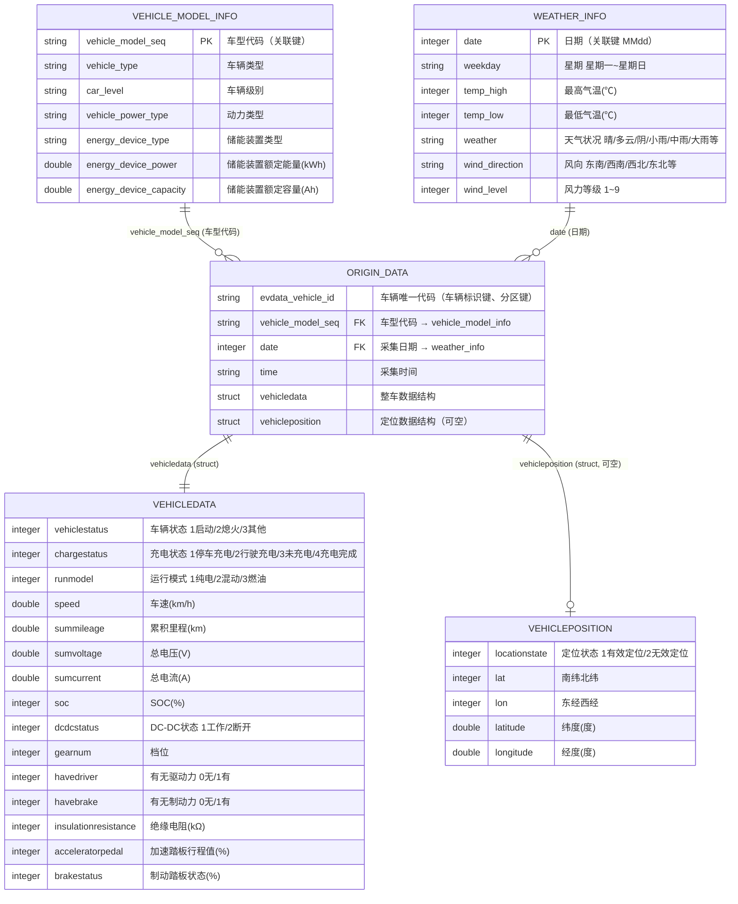
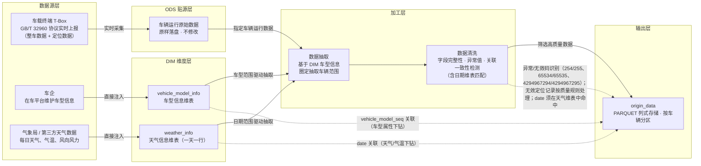

# 数据手册（Datasheet）
> **数据集名称**： 新能源汽车多车辆运行数据集  
> **数据集英文名**： EV_MORE_VEHICLE_DATASET  
> **数据版本号**： v1.0   
> **创建机构**： EVData Box团队  
> **发布日期**： 2026年9月4日  
> **文档状态**： 正式发布 
---

## 一、数据集概述与背景

### 1.1 业务场景

本数据集来源于上海市新能源汽车平台，涵盖大规模车辆群体的运行数据，数据集可主要用于以下研究目的：

- **车辆群体行为研究**：大规模车辆的 SOC 分布、充电行为、车速/里程分布等群体状态统计；
- **出行与空间特征研究**：基于定位数据的车辆空间分布、出行半径、城市热力与充电基础设施规划；
- **宏观能耗与算法研究**：群体级能耗统计、区域需求预测、车辆状态识别等算法模型训练。

### 1.2 数据明细

数据明细归为两类来源，主要包括：

| 数据来源 | 对应表 | 落地方式 |
|:---|:---|:---|
| 车平台 | origin_data | 一次性抽取 |
| 车平台 | vehicle_model_info | 一次性抽取 |
| 网络 | vehicle_model_info | 一次性抽取 |

### 1.3 适用场景与慎用建议

**适用场景：**
- 多车辆行为对比聚类分析
- 最优路径规划

**慎用建议：**

- **不适合用于微观行为探究**：运行数据时间间隔10s或30s，不适合对三急行为（急加速、急减速、急转弯）等数据频率要求极高的场景。
- **不适合用于单车长周期衰减分析**：本数据集面向多车辆群体横向分析；如需单车电池衰减/寿命等长周期纵向追踪，请使用**新能源汽车长周期数运行据集**。
- **不包含三电深度字段**：本数据集不含发动机、驱动电机、电池极值（单体电压/探针温度）等结构，相关诊断分析请使用**新能源汽车长周期数运行据集**。

---

## 二、数据结构与规模

### 2.1 核心统计指标

| 指标 | 数值 |
|:---|:---|
| 数据时间范围 | 某年07-01 — 07-14 |
| 涉及数据表 | 3 个（origin_data、vehicle_model_info、weather_info） |
| 总文件大小 | 约 760 MB（PARQUET 格式） |
| 数据总行数 | 约 4100 万（以 origin_data 为主） |
| origin_data 表行数 | 约 4100 万 |
| vehicle_model_info 表行数 | 4 行 |
| weather_info 表行数 | 14 行 |
| 存储格式 | PARQUET 格式 |
| 分区策略 | origin_data 表按 `date`（日期）分区 |

### 2.2 实体关系图（ER图）

> 关联关系：`origin_data.vehicle_model_seq`（外键，多）→ `vehicle_model_info.vehicle_model_seq`（主键，一），即**一个车型对应多条车辆上报数据**。origin_data 为嵌套结构（struct），ER 图中按结构组展开展示。




### 2.3 关联逻辑说明

1. **主表关系（两表核心关联）**：`vehicle_model_info`（车型维表，一）: `origin_data`（车辆上报事实数据，多）= 1 : N，通过 `vehicle_model_seq` 关联。分析时先按车型维度筛选/聚合，再下钻到车辆明细。注意本数据集 `vehicle_model_seq` 为 **string 类型**，join 时需与维表主键类型保持一致。
2. **日期维表关联**：`weather_info`（天气维表，一）: `origin_data`（多）= 1 : N，通过 `date`（整型 MMdd）关联。一天对应大量车辆上报记录，`date` 同时承担分区过滤与天气下钻双重作用，关联后可做"不同天气/气温条件下的车辆状态分析"。
3. **嵌套结构**：origin_data 中 `vehicledata`（整车数据）、`vehicleposition`（定位数据）均为 struct，每行数据各含一个；`vehicleposition` 可为空（无定位上报时整体为 NULL）。
4. **分区策略**：origin_data 表按 `date`（日期）分区。

### 2.4 字段级描述（数据字典）

> 敏感等级：🔴 L3-高（车辆唯一标识，可关联到具体车辆）/ 🟡 L2-中（时间类、位置类字段）/ 🟢 L1-低（车辆运行遥测数据）。  
> 标准编码约定：**254(0xFE)=异常、255(0xFF)=无效**（双字节为 65534/65535，4字节为 4294967294/4294967295）。

#### 1. origin_data 根节点字段

| 字段名(Field) | 数据类型 | 中文释义 | 必填 | 主/外键 | 取值范围/枚举值 | 单位 | 敏感等级 | 处理逻辑/备注 |
|:---|:---|:---|:---:|:---|:---|:---:|:---:|:---|
| evdata_vehicle_id | `STRING` | 车辆唯一代码 | ✅ | 车辆标识键、分区键 | 车辆唯一标识（脱敏ID） | — | 🔴 L3 | 单车辆多条记录，非主键；已脱敏 |
| vehicle_model_seq | `STRING` | 车型代码 | ✅ | **FK**→vehicle_model_info.vehicle_model_seq | 关联车型维表 | — | 🟢 L1 | **string 类型**，与 vehicle_model_info 关联的外键 |
| time | `STRING` | 采集时间 | ✅ | — | HH:mm:ss | — | 🟡 L2 | 字符串，UTC+8 |
| date | `INTEGER` | 日期 | ✅ | — | 整型日期（MMdd） | — | 🟡 L2 | 整型而非字符串，过滤写法见避坑指南 |

#### 2. vehicledata 整车数据（struct）

| 字段名(Field) | 数据类型 | 中文释义 | 必填 | 主/外键 | 取值范围/枚举值 | 单位 | 敏感等级 | 处理逻辑/备注 |
|:---|:---|:---|:---:|:---|:---|:---:|:---:|:---|
| vehicledata.vehiclestatus | `INTEGER` | 车辆状态 | ✅ | — | 1：启动；2：熄火；3：其他；254：异常；255：无效 | — | 🟢 L1 | 254/255 应过滤或置 NULL |
| vehicledata.chargestatus | `INTEGER` | 充电状态 | ✅ | — | 1：停车充电；2：行驶充电；3：未充电；4：充电完成；254：异常；255：无效 | — | 🟢 L1 | 254/255 应过滤或置 NULL |
| vehicledata.runmodel | `INTEGER` | 运行模式 | ✅ | — | 1：纯电；2：混动；3：燃油；254：异常；255：无效 | — | 🟢 L1 | BEV 车通常为 1，PHEV 随工况切换 |
| vehicledata.speed | `DOUBLE` | 车速 | ✅ | — | 0~220，0.1 步长；65534：异常；65535：无效 | km/h | 🟢 L1 | — |
| vehicledata.summileage | `DOUBLE` | 累积里程 | ✅ | — | 0~999999.9，0.1 步长；4294967294/4294967295：异常/无效 | km | 🟢 L1 | 只增不减，可用于校验数据连续性 |
| vehicledata.sumvoltage | `DOUBLE` | 总电压 | ✅ | — | 0~1000，0.1 步长；65534：异常；65535：无效 | V | 🟢 L1 | — |
| vehicledata.sumcurrent | `DOUBLE` | 总电流 | ✅ | — | -1000~+1000，0.1 步长；65534：异常；65535：无效 | A | 🟢 L1 | 负值放电、正值充电 |
| vehicledata.soc | `INTEGER` | SOC 剩余电量 | ✅ | — | 0~100，1 步长；254：异常；255：无效 | % | 🟢 L1 | 剩余电量百分比 |
| vehicledata.dcdcstatus | `INTEGER` | DC-DC 状态 | ✅ | — | 1：工作；2：断开；254：异常；255：无效 | — | 🟢 L1 | — |
| vehicledata.gearnum | `INTEGER` | 档位 | ✅ | — | 0：空挡；1~6：1~6挡；13：R 倒挡；14：D 前进挡；15：P 停车挡 | — | 🟢 L1 | 枚举映射后再分析 |
| vehicledata.havedriver | `INTEGER` | 有无驱动力 | ✅ | — | 0：无；1：有 | — | 🟢 L1 | 注意：与 havebrake 含义相反，勿混淆 |
| vehicledata.havebrake | `INTEGER` | 有无制动力 | ✅ | — | 0：无；1：有 | — | 🟢 L1 | — |
| vehicledata.insulationresistance | `INTEGER` | 绝缘电阻 | — | — | 0~60000，1 步长 | kΩ | 🟢 L1 | 低于 100kΩ 存在漏电风险 |
| vehicledata.acceleratorpedal | `INTEGER` | 加速踏板行程值 | — | — | 0~100，1 步长；254：异常；255：无效 | % | 🟢 L1 | — |
| vehicledata.brakestatus | `INTEGER` | 制动踏板状态 | — | — | 0~100 行程百分比；0：制动关；101：制动有效；254：异常；255：无效 | % | 🟢 L1 | 注意 101 为特殊状态位，非行程值 |

#### 3. vehicleposition 定位数据（struct，可为空）

| 字段名(Field) | 数据类型 | 中文释义 | 必填 | 主/外键 | 取值范围/枚举值 | 单位 | 敏感等级 | 处理逻辑/备注 |
|:---|:---|:---|:---:|:---|:---|:---:|:---:|:---|
| vehicleposition.locationstate | `INTEGER` | 定位状态 | ✅ | — | 0：有效定位；1：无效定位 | — | 🟢 L1 | 当数据通信正常，而不能获取定位信息时，发送最后一次有效定位信息，并将定位状态位置为无效 |
| vehicleposition.lat | `INTEGER` | 南纬北纬 | — | — | 0：北纬；1：南纬 | — | 🟡 L2 | — |
| vehicleposition.lon | `INTEGER` | 东经西经 | — | — | 0：东经；1：西经 | — | 🟡 L2 | — |
| vehicleposition.latitude | `DOUBLE` | 纬度 | — | — | 以度为单位的纬度值乘以10^6，精确到百万分之一度 | ° | 🟡 L2 | — |
| vehicleposition.longitude | `DOUBLE` | 经度 | — | — | 以度为单位的经度值乘以10^6，精确到百万分之一度 | ° | 🟡 L2 | — |


#### 4. vehicle_model_info 车型信息维表

| 字段名(Field) | 数据类型 | 中文释义 | 必填 | 主/外键 | 取值范围/枚举值 | 单位 | 敏感等级 | 处理逻辑/备注 |
|:---|:---|:---|:---:|:---|:---|:---:|:---:|:---|
| vehicle_model_seq | `STRING` | 车型代码 | ✅ | **PK** | 唯一 | — | 🟢 L1 | 主键，被 origin_data 引用；**string 类型** |
| vehicle_type | `STRING` | 车辆类型 | ✅ | — | Sedan/SUV/MPV（以维表枚举为准） | — | 🟢 L1 | — |
| car_level | `STRING` | 车辆级别 | — | — | A00/A0/A/B/C/D（以维表枚举为准） | — | 🟢 L1 | — |
| vehicle_power_type | `STRING` | 动力类型 | ✅ | — | BEV 纯电 / PHEV 插混 / FCEV 燃料电池 | — | 🟢 L1 | 决定哪些结构字段有值 |
| energy_device_type | `STRING` | 储能装置类型 | — | — | 磷酸铁锂/三元锂等电池类型 | — | 🟢 L1 | — |
| energy_device_power | `DOUBLE` | 储能装置额定能量 | — | — | ≥0 | kWh | 🟢 L1 | — |
| energy_device_capacity | `DOUBLE` | 储能装置额定容量 | — | — | ≥0 | Ah | 🟢 L1 | — |

#### 5. weather_info 天气信息维表

| 字段名(Field) | 数据类型 | 中文释义 | 必填 | 主/外键 | 取值范围/枚举值 | 单位 | 敏感等级 | 处理逻辑/备注 |
|:---|:---|:---|:---:|:---|:---|:---:|:---:|:---|
| date | `INTEGER` | 日期 | ✅ | **PK** | 整型 MMdd（如 0701）；唯一 | — | 🟡 L2 | 与 origin_data.date 类型一致，关联键 |
| weekday | `STRING` | 星期 | ✅ | — | 星期一/星期二/星期三/星期四/星期五/星期六/星期日 | — | 🟢 L1 | 辅助字段，分析可结合 date 自行派生 |
| temp_high | `INTEGER` | 最高气温 | ✅ | — | 整数，如 25~42 | ℃ | 🟢 L1 | 当天最高气温，可直接使用 |
| temp_low | `INTEGER` | 最低气温 | ✅ | — | 整数，如 -20~30 | ℃ | 🟢 L1 | 当天最低气温，可直接使用 |
| weather | `STRING` | 天气状况 | ✅ | — | 晴 / 多云 / 阴 / 小雨 / 中雨 / 大雨；可带过渡态如"小雨-阴"、"阴-晴"、"晴-多云" | — | 🟢 L1 | 含多种写法，建议聚合前先归一到主天气枚举 |
| wind_direction | `STRING` | 风向 | ✅ | — | 东南风 / 西南风 / 东北风 / 西北风 / 东风 / 南风 / 西风 / 北风 | — | 🟢 L1 | 建议归一到八方位枚举 |
| wind_level | `INTEGER` | 风力等级 | ✅ | — | 1~9 | 级 | 🟢 L1 | — |
---

## 三、数据质量与治理

### 3.1 数据血缘与加工流程



**加工环节说明：**

1. **采集层**：车平台实时采集车辆运行数据（整车、定位等 GB/T 32960 报文），写入 ODS 层；车企在车平台维护车型信息，直接注入 DIM 层；天气数据（最高气温、最低气温、天气状况、风向、风力）由气象局或第三方天气数据源按日同步，直接注入 DIM 层 `weather_info`（一天一行，整型 `date` 作为主键）。
2. **抽取层**：基于 DIM 层车型信息圈定目标车型/车辆范围，并基于 DIM 层天气信息圈定目标日期范围，从 ODS 层抽取对应车辆 + 对应日期的运行数据。即"抽哪些车"由车型维表决定，"抽哪几天"由天气维表决定。
3. **清洗层**：执行字段完整性、异常值、关联一致性等检测，筛选高质量的车辆数据；同时校验 `date` 字段须命中 `weather_info` 维表，确保输出数据可下钻天气维度。
4. **输出层**：清洗完成后导出为 PARQUET 格式，按车辆分区存储。

### 3.2 已知数据质量问题

| 问题类型 | 涉及字段 | 影响程度 | 处理方式 | 备注 |
|:---|:---|:---:|:---|:---|
| 无效定位 | vehicleposition.locationstate、lat、lon | 中 | 分析侧过滤 | locationstate=2（无效定位）或经纬度为无效码时坐标不可用；空间分析前必须过滤，否则轨迹/热力图会出现异常点 |
| 定位结构缺失 | vehicleposition | 低 | 保留 | 部分车辆/报文不含定位结构【缺失率待填充】，非定位类分析不受影响 |
| 时间空白 | date、time | 低 | 未处理 | 车辆停车/熄火不上传数据时可能出现数据断点，可结合 chargestatus/vehiclestatus 状态推断车辆是否停靠 |
| 数据冗余度 | ALL | 中 | 未处理 | 车辆静止时持续上报高度相似数据【冗余比例待填充】，群体统计时可按车辆状态去重 |
| 外键类型 | vehicle_model_seq | 低 | 使用时注意 | string 类型，与维表或其他数据集 join 时需显式统一类型 |
| 遥测异常码 | vehicledata 各字段 | 中 | 分析侧过滤/置 NULL | 254/255、65534/65535、4294967294/4294967295 等国标异常/无效码，聚合统计前需排除 |

### 3.3 数据一致性校验

- **主键一致性校验**：`vehicle_model_info.vehicle_model_seq` 在维表中唯一、无重复。
- **外键一致性校验**：`origin_data.vehicle_model_seq` 与 `vehicle_model_info` 表中主键类型一致，维表命中率100%。
- **分区策略校验**：origin_data 按 `date`（日期）分区，查询不带分区将全表扫描，影响查询效率。

### 3.4 隐私与安全合规

| 合规项 | 说明 |
|--------|------|
| 数据脱敏 | `evdata_vehicle_id` 已随机编码脱敏，不可逆推原始ID |
| 敏感信息排除 | 不包含手机号、身份证号、银行卡号、收货地址等PII信息 |
| 数据授权 | 数据集内部使用需经审批；对外共享需签署数据保密协议 |
| 合规依据 | 符合《个人信息保护法》《数据安全法》相关要求 |
| 访问控制 | 仅限授权团队成员访问，禁止二次分发 |

---

## 四、版本与维护

### 4.1 版本更新记录

| 版本号 | 日期 | 变更内容 | 负责人 |
|:---|:---|:---|:---|
| v1.0 | 2026-09-04 | 首次发布，覆盖整车数据 + 定位数据 | EVData Box 团队 |

### 4.2 更新计划

- **更新频率**：按年更新
- **更新内容**：每年发布新一年新增数据
- **下次更新**：预计2027年9月1日发布新一年数据

### 4.3 联系方式

| 联系方式 | 联系信息 |
|:---|:---|
| EVData Box 团队 | labs@shevdc.org |

---

## 五、引用与致谢

### 5.1 标准引用格式

**学术引用（BibTeX）：**

```bibtex
@dataset{EV_MORE_VEHICLE_DATASET,
  title   = {{新能源汽车多车辆运行数据集 v1.0}},
  author  = {{EVData Box 团队}},
  year    = {2026},
  version = {1.0},
  publisher = {上海市新能源汽车公共数据采集与监测研究中心}
}
```

**文本引用格式：**

> 上海市新能源汽车公共数据采集与监测研究中心EVData Box团队. 新能源汽车多车辆运行数据集 (v1.0) [Data set]. 上海市新能源汽车公共数据采集与监测研究中心, 2026.

### 5.2 致谢

感谢以下团队在数据采集、清洗与治理过程中的贡献：
- 平台技术团队：负责采集系统建设与日志采集链路维护
- 数据中台团队：负责数据清洗、质量管控与数据集发布
- 安全合规团队：负责数据脱敏方案设计与合规审查

---

## 六、使用建议与避坑指南

### 6.1 最容易犯的错误

#### 1. 查询 origin_data 时不带分区过滤

这是最常见的性能问题。origin_data 表按 `date`（日期）分区。如果查询时不带 `evdata_vehicle_id` 或 `date` 过滤，每次查询都会全表扫描，在大数据集群上会造成资源浪费甚至任务超时。

#### 2. 未过滤无效定位直接做空间分析

`locationstate=2`（无效定位）或经纬度为无效码时，坐标可能落在 (0,0) 或异常位置，直接绘制轨迹/热力图会出现"轨迹飘到海上"等问题。做空间分析前必须先过滤 `locationstate = 1` 并排除经纬度无效码记录。

### 6.2 重要注意事项


#### 1. date 是整型、vehicle_model_seq 是 string

`date` 为整型 MMdd（如 0908），写 `date = '2026-09-01'` 无法命中，应按整型写法过滤（如 `date BETWEEN 20260901 AND 20260930`）；`vehicle_model_seq` 为 string 类型，与其他数据集（可能为 integer）关联前需显式统一类型。

#### 2. 本数据集不含三电深度字段

本数据集**不含** enginedata（发动机）、extremevalue（电池极值/单体电压）、motordatalist（驱动电机）结构。需要电池单体电压、电机温度/转矩、发动机转速等字段时，请使用长周期数据集或对应专项数据集，勿在本表中查找。

#### 3. 位置数据的合规红线

即使车辆 ID 已脱敏，连续轨迹仍可能间接关联到个人。任何分析都应停留在群体/区域聚合层面（如区域车辆数、平均停留时长），不得输出单车可识别的轨迹明细用于对外场景。


---

> **文档维护说明：** 本数据手册随数据集版本同步更新。如发现数据质量问题或文档描述不准确，请联系 labs@shevdc.org。
>
> **配套文件：** 完整字段数据字典请参阅 `新能源汽车长周期运行数据集_数据字典.xlsx`。

---