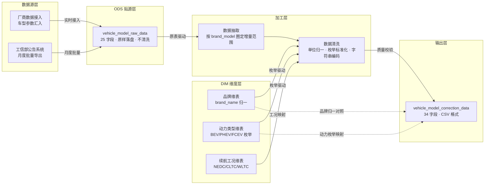

# 数据手册（Datasheet）

> **数据集名称**：新能源汽车车型信息数据集  
> **数据集英文名**：EV_VEHICLE_MODEL_DATASET  
> **数据版本号**：v1.0  
> **创建机构**：EVData Box团队  
> **发布日期**：2026-09-10  
> **文档状态**：正式发布

---

## 一、数据集概述与背景

### 1.1 业务场景

本数据集来源于新能源厂商与工信部机动车车型数据汇编，覆盖**新能源汽车典型车型**的参数化属性。本数据集主要服务于以下研究目的：

- **车型参数化建模**：以统一字段描述车辆基础参数、动力电池与续航等信息，用于车辆队列分析与车型聚类研究。
- **公告数据清洗与质量提升**：对比"原始入库"与"修正入库"两套字段，验证数据治理规则（如单位统一、枚举标准化、空值补全）的有效性。
- **行业研究**：支持车型级别（微型 / 紧凑型 / 中大型）、动力类型（BEV / PHEV / FCEV）、续航工況（NEDC / CLTC / WLTC）等多维度对比分析。

### 1.2 数据明细

数据明细归为 **2** 类来源（同一公告体系下的"原始快照"与"修正快照"），主要包括：

| 数据来源                   | 对应表                                        | 落地方式  |
| :--------------------- | :----------------------------------------- | :---- |
| 工信部公告 / 厂商接入 → 一次性批量入库 | `vehicle_model_raw_data`（车型信息原始数据表）        | 一次性抽取 |
| 经清洗、单位归一、枚举标准化后 → 入仓   | `vehicle_model_correction_data`（车型信息修正数据表） | 一次性抽取 |

### 1.3 适用场景与慎用建议

**适用场景：**

- 车型维度的横向对比、聚类与对标研究。
- 数据治理前后质量对比研究（clean-before / clean-after）。
- 续航参数（NEDC / CLTC / WLTC）多工况对比分析。

**慎用建议：**

- **不适合用于单车级的实时运行数据分析**：本数据集描述的是"车型级静态参数"，不含车辆运行遥测、电池极值、故障码等字段。
- **不适合用于市场价格成交分析**：`factory_sales_price_from` / `factory_sales_price_to` 为厂家指导价区间，**不含经销商终端成交价与区域差异**。
- **不适合用于个人 PII / 用户画像研究**：本数据集不包含车主、驾驶员或行驶轨迹数据，无法支撑个体层面分析。

---

## 二、数据结构与规模

### 2.1 核心统计指标

| 指标| 数值 |
| :------- | :---------|
| 数据时间范围    | 2019 — 2026   |
| 涉及数据表   | 2 个（`vehicle_model_raw_data`、`vehicle_model_correction_data`） |
| 总文件大小    | 约 45 KB（EXCEL 格式）      |
| 数据总行数   | 200 行|
| `vehicle_model_raw_data` 表行数  | 100 行       |
| `vehicle_model_correction_data` 表行数 | 100行    |
| 存储格式    | EXCEL 格式      |
| 分区策略    | —  |

### 2.2 实体关系图（ER图）

> 关联关系：`vehicle_model_raw_data.brand_model`（多）→ `vehicle_model_correction_data.brand_model`（一），即同一车款在"原始入库"与"修正入库"两端形成一对一修正关系，**通过 `brand_modelq` 关联**。

```mermaid
erDiagram
    VEHICLE_MODEL_RAW_DATA ||--|| VEHICLE_MODEL_CORRECTION_DATA : "brand_model 外键 (一对一同车型修正)"

    VEHICLE_MODEL_RAW_DATA {
        string brand_name "品牌名称"
        string brand_model PK "品牌型号"
        string total_weight "总质量(kg)"
        string electric_endurance "纯电续航(km)"
        string max_speed "最高车速(km/h)"
        string size_lwh "长×宽×高(mm)"
        string hundredkm_acceleration "百公里加速时间(s)"
        string fiftykm_acceleration "五十公里加速时间(s)"
        string vehicle_model "车型名称"
        string vehicle_type "车辆类型"
        string carrier_num "载客人数"
        string curb_weight "整备质量(kg)"
        string uniform_speed_endurance "等速续航(km)"
        string vehicle_power_type "动力类型"
        string listing_time "上市时间"
        string wheel_base "轴距(mm)"
        string hundredkm_powerconsump "百公里电耗/油耗"
        double factory_sales_price_from "厂商指导价(起)"
        double factory_sales_price_to "厂商指导价(止)"
        string produce_mode "生产方式"
        string brand_type "品牌类型"
        string passenger_car_level "乘用车级别"
    }

    VEHICLE_MODEL_CORRECTION_DATA {
        string brand_model PK "品牌型号"
        string org_name "生产企业名称"
        string brand_name "品牌名称"
        string sales_org_name "销售组织名称"
        string sales_brand "销售品牌"
        string sales_name "销售名称"
        string enterprise_form "企业性质"
        string brand_level "品牌级别"
        string vehicle_use_type "车辆使用类型"
        string vehicle_type "车辆类型"
        string car_level "车辆级别"
        string vehicle_power_type "动力类型"
        string vehicle_power_type_add "动力类型补充说明"
        string amount_weight "总质量(kg)"
        string curb_weight "整备质量(kg)"
        string wheel_base "轴距(mm)"
        string height "高度(mm)"
        string length "长度(mm)"
        string width "宽度(mm)"
        string energy_device_power "储能装置功率(kW)"
        string energy_device_capacity "储能装置容量(kWh)"
        string energy_device_type "储能装置类型"
        string comprehensive_nedc "NEDC综合续航(km)"
        string constant_speed_nedc "NEDC等速续航(km)"
        string comprehensive_cltc "CLTC综合续航(km)"
        string comprehensive_wltc "WLTC综合续航(km)"
        string yearly_model "年款"
        string high_voltage_platform "高压平台电压(V)"
        string comprehensive_endurance "综合续航(km)"
    }
```



### 2.3 关联逻辑说明

1. **同车型跨版本关联**：`vehicle_model_raw_data`（原始快照，一）: `vehicle_model_correction_data`（修正快照，一）= 1 : 1，通过 `brand_model` 关联，**用于对比数据治理前后的字段差异**。
2. **品牌维度下钻**：两份表均含 `brand_name` 与 `brand_model`，可按品牌或车型系列进行横向聚合统计分析。
3. **动力类型枚举对齐**：`vehicle_power_type` 在两份表含义一致，但 `correction_data` 表额外提供 `vehicle_power_type_add`（如"增程"/"换电"等补充标识）。


### 2.4 字段级描述（数据字典）

> 敏感等级：🔴 L3-高（车型备案型号，可关联到具体车款主体）/ 🟡 L2-中（时间类字段，如 `listing_time` / `join_date`，可间接反映商业周期）/ 🟢 L1-低（车辆规格、续航、动力类型等业务参数）。  


#### ① `vehicle_model_raw_data` 表（车型信息原始数据表）

| 字段名(Field)                 | 数据类型      | 中文释义     |  必填 | 主/外键   | 取值范围/枚举值                      |          单位         |   敏感等级  | 处理逻辑/备注                                                                               |
| :------------------------- | :-------- | :------- | :-: | :----- | :---------------------------- | :-----------------: | :-----: | :------------------------------------------------------------------------------------ |
| `brand_name`               | `STRING`  | 品牌名称     |  ✅  | —      | 例如"比亚迪"、"特斯拉"、"蔚来"            |          —          | 🟢 L1-低 | "原始"端字符串可能存在前后空格或异体写法                                                                 |
| `brand_model`              | `STRING`  | 车型备案型号     |  ✅  | **PK**   |   工信部车型备案型号    |          —          | 🔴 L3-高 | 与 `correction_data.brand_model` 构成复合关联键                                               |
| `total_weight`             | `STRING`  | 总质量      |  —  | —      | 字符串型数字，例如"2200"               |          kg         | 🟢 L1-低 | 单位本应统一为 kg；存在多种字符表示，请按需 cast 为数值                                                      |
| `electric_endurance`       | `STRING`  | 纯电续航     |  —  | —      | 字符串型数字，例如"605"                |          km         | 🟢 L1-低 | BEV/PHEV 均有意义，缺值可能为 FCEV/燃油                                                           |
| `max_speed`                | `STRING`  | 最高车速     |  —  | —      | 字符串型数字，例如"200"                |         km/h        | 🟢 L1-低 | —                                                                                     |
| `size_lwh`                 | `STRING`  | 长×宽×高    |  —  | —      | 例如"4980×1910×1495"            |          mm         | 🟢 L1-低 | 三个数用 `×` 或 `*` 分隔                                                                     |
| `hundredkm_acceleration`   | `STRING`  | 百公里加速时间  |  —  | —      | 字符串型数字，例如"3.9"                |          s          | 🟢 L1-低 | —                                                                                     |
| `fiftykm_acceleration`     | `STRING`  | 五十公里加速时间 |  —  | —      | 字符串型数字，例如"2.0"                |          s          | 🟢 L1-低 | 通常用于性能车指标                                                                             |
| `vehicle_model`            | `STRING`  | 车型名称     |  —  | —      | 例如"纯电动轿车"                     |          —          | 🟢 L1-低 | 与 `vehicle_type` 不同：此为通用类别名                                                           |
| `vehicle_type`             | `STRING`  | 车辆类型     |  —  | —      | 例如"轿车"、"SUV"、"MPV"、"客车"       |          —          | 🟢 L1-低 | 与 `correction_data.vehicle_type` 含义一致                                                 |
| `carrier_num`              | `STRING`  | 载客人数     |  —  | —      | 字符串型整数，例如"5"                  |          人          | 🟢 L1-低 | 商用车可能为大数值                                                                             |
| `curb_weight`              | `STRING`  | 整备质量     |  —  | —      | 字符串型数字                        |          kg         | 🟢 L1-低 | —                                                                                     |
| `uniform_speed_endurance`  | `STRING`  | 等速续航     |  —  | —      | 字符串型数字                        |          km         | 🟢 L1-低 | 通常为 60km/h 等速条件下的续航                                                                   |
| `vehicle_power_type`       | `STRING`  | 动力类型     |  —  | —      | BEV / PHEV / FCEV / HEV / ICE |          —          | 🟢 L1-低 | 与 `correction_data.vehicle_power_type` 含义一致                                           |
| `listing_time`             | `STRING`  | 上市时间     |  —  | —      | 例如"2021-03"                   |         年-月         | 🟡 L2-中 | 通常只有年-月精度，可能仅月份                                                                       |
| `wheel_base`               | `STRING`  | 轴距       |  —  | —      | 字符串型数字，例如"2920"               |          mm         | 🟢 L1-低 | —                                                                                     |
| `hundredkm_powerconsump`   | `STRING`  | 百公里电耗或油耗 |  —  | —      | 字符串型数字，例如"13.5"               | kWh/100km 或 L/100km | 🟢 L1-低 | 单位混用，需根据 `vehicle_power_type` 区分                                                      |
| `factory_sales_price_from` | `DOUBLE`  | 厂商指导价（起） |  —  | —      | 例如 `22.98`                    |    —               | 🟢 L1-低 | 起售价                                                                                   |
| `factory_sales_price_to`   | `DOUBLE`  | 厂商指导价（止） |  —  | —      | 例如 `32.98`                    |    —              | 🟢 L1-低 | 顶配价                                                                                   |
| `produce_mode`             | `STRING`  | 生产方式     |  —  | —      | 例如"国产"、"合资"、"进口"              |          —          | 🟢 L1-低 | —                                                                                     |
| `brand_type`               | `STRING`  | 品牌类型     |  —  | —      | 例如"传统车企"、"造车新势力"、"合资"         |          —          | 🟢 L1-低 | —                                                                                     |
| `passenger_car_level`      | `STRING`  | 乘用车级别    |  —  | —      | 例如"A00"、"A0"、"A"、"B"、"C"、"D"  |          —          | 🟢 L1-低 | 仅适用于乘用车；商用车无该字段                                                                       |

#### ② `vehicle_model_correction_data` 表（车型信息修正数据表）

| 字段名(Field)                | 数据类型     | 中文释义      |  必填 | 主/外键   | 取值范围/枚举值                                        |  单位 |   敏感等级  | 处理逻辑/备注                                  |
| :------------------------ | :------- | :-------- | :-: | :----- | :---------------------------------------------- | :-: | :-----: | :--------------------------------------- |
| `brand_model`             | `STRING` | 车型备案型号      |  ✅  | **PK**  | 工信部车型备案型号                              |  —  | 🔴 L3-高 | 根据国标制定         |
| `org_name`                | `STRING` | 车企名称    |  ✅  | —      | 例如"比亚迪汽车工业有限公司"                                 |  —  | 🟢 L1-低 | 已统一企业全称                                  |
| `brand_name`              | `STRING` | 备案品牌名      |  ✅  | —      | 例如"比亚迪牌"、"特斯拉牌"                                   |  —  | 🟢 L1-低 | 已统一归一                                    |
| `sales_org_name`          | `STRING` | 车企简称    |  ✅  | —      | 例如"比亚迪"                                 |  —  | 🟢 L1-低 | —                                        |
| `sales_brand`             | `STRING` | 销售品牌名称      |  ✅  | —      | 例如"腾势"、"方程豹"                                    |  —  | 🟢 L1-低 | 同一生产企业的不同销售子品牌                           |
| `sales_name`              | `STRING` | 销售车型名称      |  ✅  | —      | 例如"汉 EV "                              |  —  | 🟢 L1-低 | 上市的销售名                     |
| `enterprise_form`         | `STRING` | 车企类型      |  ✅  | —      | "合资"、"外资"、"自主"                      |  —  | 🟢 L1-低 | 已枚举化                                     |
| `brand_level`             | `STRING` | 品牌级别      |  ✅  | —      | 例如"非豪华"、"豪华"、"自主豪华"                               |  —  | 🟢 L1-低 | —                                        |
| `vehicle_use_type`        | `STRING` | 车辆使用类型    |  ✅  | —      | 例如"乘用车"、"商用车"                             |  —  | 🟢 L1-低 | 与 `vehicle_type` 颗粒度不同                   |
| `vehicle_type`            | `STRING` | 车辆类型      |  ✅  | —      | 例如"轿车"、"SUV"、"MPV"、"客车"                         |  —  | 🟢 L1-低 | —                                        |
| `car_level`               | `STRING` | 车辆级别      |  ✅  | —      | 例如"A0"、"A"、"B"、"C"、"D"          |  —  | 🟢 L1-低 | 修正后兼容乘用车与商用车                            |
| `vehicle_power_type`      | `STRING` | 动力类型      |  ✅  | —      | BEV / PHEV / FCEV  |  —  | 🟢 L1-低 | 主分类，已枚举                                  |
| `vehicle_power_type_add`  | `STRING` | 动力类型补充    |   ✅  | —      | 例如"增程"、"换电"                             |  —  | 🟢 L1-低 | 同一主分类下的子模式                               |
| `amount_weight`           | `INTEGER` | 总质量       |  ✅  | —      | —                                           |  kg | 🟢 L1-低 | 单位已统一为 kg                                |
| `curb_weight`             | `INTEGER` | 整备质量      |  ✅  | —      | —                                           |  kg | 🟢 L1-低 | —                                        |
| `wheel_base`              | `INTEGER` | 轴距        |  ✅  | —      | —                                           |  mm | 🟢 L1-低 | —                                        |
| `height`                  | `INTEGER` | 高度        |  ✅  | —      | —                                           |  mm | 🟢 L1-低 | 与 `raw_data.size_lwh` 的高度分量对应            |
| `length`                  | `INTEGER` | 长度        |  ✅  | —      | —                                           |  mm | 🟢 L1-低 | —                                        |
| `width`                   | `INTEGER` | 宽度        |  ✅  | —      | —                                           |  mm | 🟢 L1-低 | —                                        |
| `energy_device_power`     | `INTEGER` | 储能装置额定能量    |  ✅  | —      | —                                           |  kW | 🟢 L1-低 |                           |
| `energy_device_capacity`  | `INTEGER` | 储能装置额定容量    |  ✅  | —      | —                                           | kWh | 🟢 L1-低 |                              |
| `energy_device_type`      | `STRING` | 储能装置类型    |  ✅  | —      | 例如"三元材料电池"、"磷酸铁锂电池"                           |  —  | 🟢 L1-低 | —                                        |
| `comprehensive_nedc`      | `INTEGER` | NEDC 综合续航 |  —  | —      | —                                           |  km | 🟢 L1-低 | 老国标，已逐步被 CLTC/WLTC 替代                    |
| `constant_speed_nedc`     | `INTEGER` | NEDC 等速续航 |  —  | —      | —                                           |  km | 🟢 L1-低 | 60km/h 等速条件                              |
| `comprehensive_cltc`      | `INTEGER` | CLTC 综合续航 |  —  | —      | —                                           |  km | 🟢 L1-低 | 中国现行乘用车续航标准                              |
| `comprehensive_wltc`      | `INTEGER` | WLTC 综合续航 |  —  | —      | —                                           |  km | 🟢 L1-低 | 全球统一轻型车测试循环                              |
| `yearly_model`            | `STRING` | 年款        |  ✅  | —      | 例如"2024款"、"2023款"                                 |  年  | 🟡 L2-中 | —                            |
| `high_voltage_platform`   | `STRING` | 高压平台    |  ✅  | —      | 例如"800V"                                   |  V  | 🟢 L1-低 | 800V 为高压平台                 |
| `comprehensive_endurance` | `INTEGER` | 综合续航      |  ✅  | —      |                                           |  km | 🟢 L1-低 | 取一个上述 4 个续航里程字段中有有效值的值            |

---

## 三、数据质量与治理

### 3.1 数据血缘与加工流程



**加工环节说明：**

1. **采集层**：工信部公告系统月度批量导出 + 厂商车型数据接入，二者合并去重写入 ODS。
2. **抽取层**：基于 `brand_model` 圈定增量车款，抽取至加工层。
3. **清洗层**：①单位统一（kg / mm / km / kW / kWh）；②枚举标准化（动力类型、品牌级别、企业性质）；③品牌名称归一（"比亚迪汽车"→"比亚迪"）。
4. **输出层**：导出 CSV 格式。

### 3.2 已知数据质量问题

| 问题类型     | 涉及字段                                                   | 影响程度 | 处理方式                                    | 备注                             |
| :------- | :----------------------------------------------------- | :--: | :-------------------------------------- | :-----------------------------              |
| 单位混用     | `hundredkm_powerconsump` / `size_lwh` / `total_weight` |   中  | 修正表已统一，原始表保留原状                          | PHEV 为 L/100km，BEV 为 kWh/100km |
| 品牌名称异体   | `brand_name`                                           |   中  | 修正表枚举归一                                 | 出现"比亚迪汽车"/"比亚迪"混用              |
| 续航工況并存   | `comprehensive_nedc` / `_cltc` / `_wltc`               |   中  | 保留多工况，由使用者按需选用                          | 现行主流为 CLTC                     |


### 3.3 数据一致性校验

- **品牌枚举一致性**：修正表 `brand_name` 必须是品牌维表中的标准写法。
- **动力类型枚举值**：修正表 `vehicle_power_type` 仅允许 BEV / PHEV / FCEV 三种主分类。
- **尺寸字段交叉验证**：修正表 `length × width × height` 应与原始表 `size_lwh` 拆分后的数值在 ±5mm 内一致。
- **续航字段非空规则**：BEV 车型在三个工況（NEDC/CLTC/WLTC）中至少应有 1 个非空值，否则视为疑似数据缺失。

### 3.4 隐私与安全合规

| 合规项    | 说明                                                |
| ------ | ------------------------------------------------- |
| 数据脱敏   | 不涉及个人 PII，本数据集所有字段均为车辆级公开参数，无需脱敏                  |
| 敏感信息排除 | 不含车主、驾驶员、手机号、VIN、身份证、行驶轨迹等字段                      |
| 数据授权   | 数据来源于工信部公告与厂商公开发布材料，按"合理使用"范围二次汇编                 |
| 合规依据   | 《新能源汽车推广应用工程》、《道路机动车辆生产准入许可管理条例》、GB/T 32960 等公开标准 |
| 访问控制   | 仅限授权团队成员访问，禁止二次分发                 |

---

## 四、版本与维护

### 4.1 版本更新记录

| 版本号  | 日期         | 变更内容                       | 负责人        |
| :--- | :--------- | :------------------------- | :--------- |
| v1.0 | 2026-09-10 | 首版本发布，含原始表 22 字段与修正表 29 字段 | EVData Box 团队 |

### 4.2 更新计划

- **更新频率**：按年更新
- **更新内容**：每年发布新一年新增数据
- **下次更新**：预计2027年9月1日发布新一年数据

### 4.3 联系方式

| 联系方式   | 联系信息                 |
| :----- | :------------------- |
| EVData Box团队 | labs@shevdc.org |


---

## 五、引用与致谢

### 5.1 标准引用格式

**学术引用（BibTeX）：**

```bibtex
@dataset{EV_VEHICLE_MODEL_DATASET,
  title   = {新能源汽车车型信息数据集 v1.0},
  author  = {EVData Box 团队},
  year    = {2026},
  version = {1.0},
  publisher = {上海市新能源汽车公共数据采集与监测研究中心}
}
```

**文本引用格式：**

> 上海市新能源汽车公共数据采集与监测研究中心EVData Box团队. 新能源汽车车型信息数据集 (v1.0) [Data set]. 上海市新能源汽车公共数据采集与监测研究中心, 2026.

### 5.2 致谢

感谢以下团队在数据采集、清洗与治理过程中的贡献：

- **数据采集组**：负责公告系统对接与厂商资料补录。
- **数据治理组**：负责单位归一、枚举标准化与质量校验规则制定。
- **平台工程组**：负责数据抽取及组织。

---

## 六、使用建议与避坑指南

### 6.1 最容易犯的错误


#### 1. 把原始表当成"已清洗数据"做统计

原始表保留原始字符串，存在品牌异体（"比亚迪汽车"vs"比亚迪"）、单位混用（kWh/100km vs L/100km）等"未治理"现象。**所有面向发布的分析报表请使用 `vehicle_model_correction_data`，原始表仅用于治理前后对比与质量研究**。

#### 2. 用单一续航工況代表整车续航

同一辆车在 `comprehensive_nedc` / `_cltc` / `_wltc` 下通常差距较大（CLTC > WLTC > NEDC）。**不要默认取第一个非空值**，应结合研究目的选定工況，或在同一报告中明示工況口径。

### 6.2 重要注意事项

#### 1. `factory_sales_price_from/to` 为厂家指导价

不等于市场终端成交价，也不含经销商优惠、地方补贴、购置税减免等因子。**不要据此推断实际购买成本或性价比**。


#### 2. `vehicle_power_type` 与 `vehicle_power_type_add` 不可互替

主分类（BEV/PHEV/FCEV/HEV/ICE）由 `vehicle_power_type` 决定，补充说明（如"增程版"、"换电版"）由 `vehicle_power_type_add` 决定。**统计"BEV 数量"必须 only 使用 `vehicle_power_type='BEV'`，不可依赖 `vehicle_power_type_add`**。

#### 3. `comprehensive_endurance` 为派生字段

通常为 `comprehensive_cltc` 在数据治理阶段写入的派生值；当 CLTC 为空时可能取 WLTC/NEDC 兜底。**如果研究需要严格区分工況，请改用 `comprehensive_cltc`/`_wltc`/`_nedc` 三字段明确指定**。

---

> **文档维护说明：** 本数据手册随数据集版本同步更新。如发现数据质量问题或文档描述不准确，请联系 labs@shevdc.org
>
> **配套文件：** 完整字段数据字典请参阅 `新能源汽车车型信息数据集_数据字典.xlsx`.

